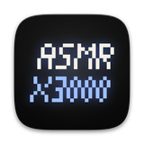
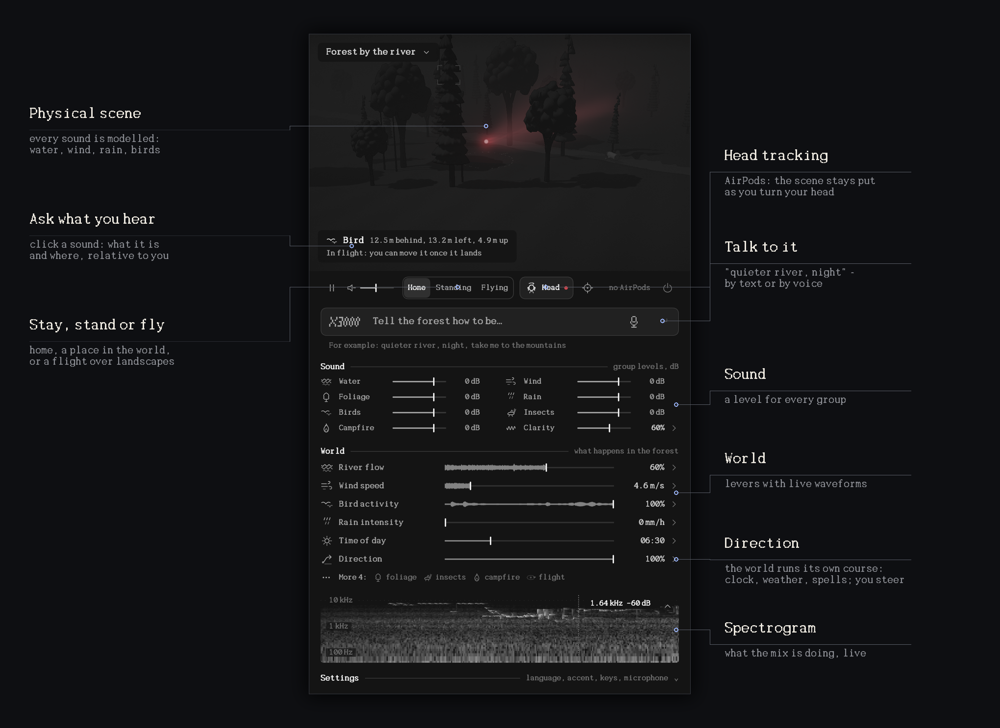

<p align="center"></p>

<h1 align="center">ASMR X3000</h1>

<p align="center">Physically simulated sound environments for macOS, in real time.<br>Binaural, head-tracked through AirPods, and never the same twice.</p>



## What it does

- **Physical scenes.** Water, wind, rain, thunder, birds, insects and fire are modelled, not looped. They travel through air and ground in 3rd-order Ambisonics and are rendered binaurally with a measured HRTF. See [spatial-engine](docs/spatial-engine.md) and [physical-models](docs/physical-models.md).
- **Head tracking.** With AirPods the scene stays fixed in the world as you turn your head.
- **Direction.** The world runs its own course: the clock moves, and weather spells come and go (a shower, a thunderstorm, mist at dawn). You steer it rather than set it: fairer or wetter, calmer or livelier, steadier or more eventful. You can also call up a spell, and anything you set by hand is left to you. See [direction](docs/direction.md).
- **Living birds.** Every bird has its own territory, song posts, feeding, flight style and neighbours to answer. See [director](docs/director.md).
- **Talk to it.** "Quieter river, night", "let it rain soon", by text or by voice. See [prompt-control](docs/prompt-control.md).
- **Places.** Three scenes, all procedural: a forest by a river, under water, and a body scan. No sound files are shipped; every sound is synthesised.

## Build

Requirements: macOS 14+, Xcode, and Rust (rustup). Head tracking needs AirPods Pro, Max, or 3rd generation and later.

```bash
scripts/build-macos.sh
```

```bash
cargo test --manifest-path core/Cargo.toml
```

Plan a scene's direction hours ahead, without audio:

```bash
cargo run --release --manifest-path core/Cargo.toml --example direction -- 10 hour=6 cue=150:thunderstorm
```

## Layout

```
core/        Rust engine: sources → propagation → Ambisonics → binaural; C ABI in include/asmr.h
  scenes/    scenes as JSON
apps/macos/  SwiftUI menu bar app (AVAudioEngine, CoreMotion, Metal stage)
docs/        design notes and research
```

## Notes

- If macOS "Spatialize Stereo" is on for the app, turn it off. The engine spatialises itself.
- The build is signed ad hoc. After a rebuild macOS may ask for Motion & Fitness access again.
- `ASMRX3000 --snapshot out.png [--scene file.json] [--expand group] [--more] [--set key=value]` renders the panel to a PNG without an audio device.
