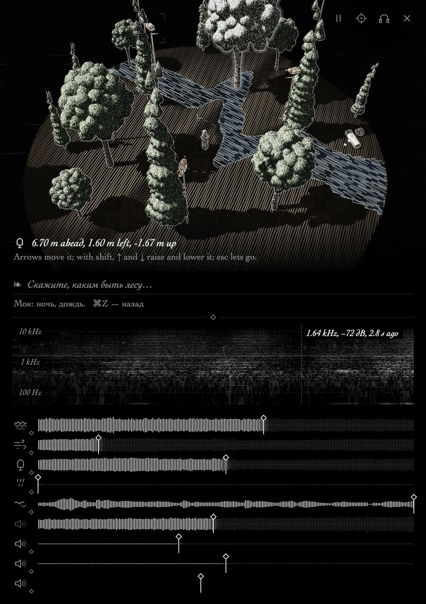

# Управление промптом

Пользователь пишет (или говорит в микрофон) просьбу обычными словами («поспокойнее», «ночь, лёгкий дождь стихает», «как будто у водопада», «перенеси меня в горы, где идёт снег», «что вокруг?»). Языковая модель получает просьбу и **текущее состояние** и возвращает набор изменений параметров. Движок плавно ведёт к ним значения. Ползунки остаются: промпт — ещё один способ ими управлять, на том же словаре.



## Поток

```
текст ─► PromptRequest (system + context + state + tool schema из ядра)
      ─► PromptProvider.complete()  (адаптер провайдера, HTTP)
      ─► PromptReply (вход инструмента = патч + explanation)
      ─► asmr_apply_patch_json ─► плавные переходы + undo-патч (⌘Z)
```

Всё, что видит модель, строит ядро (`core/src/prompt.rs`), поэтому адаптер только переносит данные и тестируется вместе с ядром.

## ABI (core/include/asmr.h)

Все три функции можно вызывать из любого потока. Вход и выход — JSON в UTF-8. Функция пишет результат с завершающим NUL в `out`, только если `max` больше его длины, а возвращает длину в любом случае: сначала вызовите с `out = NULL`, чтобы узнать размер буфера.

| Функция | Что делает |
|---|---|
| `asmr_get_state_json` | `controls`: `key`, `group`, `macro` или `parent`, `value`, `min`/`max`, `log`, `unit`, `default`, `overridden`; у пресетов ещё `option` и `options`; у громкостей групп (`<group>.level`, флаг `1<<4`) `loudness: true`. `environment`: идёт ли звук, дождь сейчас, мокрость листвы, грунт, реверберация. `scene`, `summary_ru`, `summary_topics_ru` — «что вокруг» (ниже). `objects`: `id`, `kind`, `pos`, `movable`, `moving`. Плюс `frame` (система координат) и `gliding` (сколько переходов идёт сейчас). |
| `asmr_apply_patch_json` | Применяет патч и возвращает результат: `ok`, `applied` (`key`, итоговое `value`, прежнее `from`, `clamped`), `switched`, `moved`, `errors` (по-английски, для модели), `errors_ru` (для строки под полем), `notes` (какой псевдоним во что превратился), `undo`. |
| `asmr_get_prompt_json` | `system` — статический промпт, его можно кэшировать. `context` — текущие значения текстом и «что вокруг». `tool` — `set_scene` и его `input_schema`. `scene`, `summary_ru`, `summary_topics_ru` — как в состоянии. |

### Патч

```json
{"glide_s": 4,
 "changes": [{"key": "water.flow", "value": 0.3},
             {"key": "water.regime", "value": "rapids"},
             {"key": "water.depth", "value": "reset"},
             {"key": "rain.rate", "value": 0.2, "glide_s": 30}],
 "moves": [{"object": 3, "position": [4, 6, 0]}]}
```

* Ключи — те же `key`, что у ползунков (`AsmrControlInfo.key`). Ядро принимает и голый массив изменений, и `{"key": k, "reset": true}`.
* **Терпимый разбор** (модели пишут по-разному, а ядро не должно отвечать «не нашёл»): регистр, пробелы и дефисы; псевдонимы групп (`river.flow` → `water.flow`, `rain` → `rain.rate`, `time` → `env.time_of_day`, `focus.birds` → `mix.focus.birds`); уникальный хвост ключа (`rock_size`); опечатка до двух букв (`wind.sped`). Громкость группы: `<group>.level|volume|loudness` идёт в `<group>.level` (дБ), а если его нет — в `<group>.gain` с переводом дБ → множитель (и обратно). У группы без громкости — ошибка с подсказкой взять её макро. Значения: `"6 mm/h"`, `"-6 dB"`, `"23:30"`, `"30%"`, `true`/`false` для пресетов вида off/…; относительные `{"key", "delta": 0.2}` и `{"key", "factor": 0.5}`. Пресеты: регистр и пробелы, «as built» → `scene`, подстрока, опечатка. Форма патча: массив, `{"changes": {key: value}}`, обёртки `patch`/`input`/`set_scene`, ключи прямо на верхнем уровне, JSON внутри текста или блока ```json.
* Неизвестное попадает в `errors` / `errors_ru` («нет параметра «x» (ближе всего y)»), остальные изменения всё равно применяются.
* Значения обрезаются по диапазону, такие помечаются `clamped`. У пресетов можно передать имя или индекс. `"reset"` (или `null`) у ребёнка плавно возвращает его на кривую макро, после чего снимается флаг `overridden`. У макро `reset` значит значение по умолчанию.
* **Плавные переходы**: непрерывные контролы идут к цели по smoothstep за `glide_s` секунд (по умолчанию 4, максимум 120, задаётся на весь патч или на отдельное изменение). Первый шаг делается сразу, поэтому изменение начинает звучать без задержки. Пресеты переключаются мгновенно. Время суток идёт коротким путём через полночь (23 → 2 проходит через 0, а не через полдень).
* Переходы живут в атомарных слотах: это без блокировок, работает по настенным часам, а двигают их аудиопоток каждый блок и читатели (`asmr_get_controls`, `asmr_get_state_json`), так что они доходят до цели и на паузе. Если пользователь трогает ползунок (`asmr_set_control`, `asmr_set_param`), переход на этом контроле отменяется.
* `moves` переставляет объекты с флагом MOVABLE сразу, в пределах ±40 м по горизонтали.
* **Баланс**: если изменение физически делает группу намного громче (разлив реки — `water.flow`, ливень — `rain.rate`, шквал — `wind.speed`, больше чем на 3 дБ по оценке: вода ≈ 23·lg Q, дождь ≈ 10·lg R, ветер с листвой ≈ 45·lg U), ядро опускает её громкость (`<group>.level`, ползунки «ЗВУК»; у ветра — `wind.level` и `foliage.level`) на половину прироста, не больше 6 дБ: она заметно громче, но не заглушает остальное. Не трогается, если патч сам ставит громкость этой группы. Добавки видны в `applied`, `undo` и в поле `balanced` (`key`, `db`); строка под полем дописывает «Баланс: чуть отвёл реку». Модели (и Jev) ставят громкости только по явной просьбе и чтобы поднять то, о чём просьба, если его заглушает.
* `undo` — патч, который возвращает всё, чего коснулся исходный: макро получают прежние значения, дети прежнее значение, если были заданы явно, иначе `"reset"`; объекты возвращаются на прежние места.

## Что вокруг

`scene_facts` в ядре собирает описание сцены из живого движка: место (деревья, река, озеро, скалы, костёр), время суток, сезон, температура, погода (дождь сейчас и заданный, гроза, ветер словами), ближайшая звучащая вода (направление относительно головы и расстояние), какие птицы поют сейчас и где (впереди / слева / сзади справа …, рядом / вдали, высота тона), насекомые, костёр, гром и что громче всего (громкость групп от звукорежиссёра). Структурно — `scene`, короткими русскими фразами — `summary_ru` целиком и `summary_topics_ru` по темам (`place`, `time`, `weather`, `water`, `birds`, `life`, `loudest`, `playing`). Пример: «Стоим на месте: деревья, река. Утро (09:00), лето, +18 °C. Дождя нет, слабый ветер (5 м/с). Река: совсем рядом впереди, ~4 м. Поют 3 птицы: 2 сзади слева (рядом), впереди справа рядом. Громче всего птицы, потом вода и ветер и листва.»

Вопрос о сцене («что вокруг?», «где птицы?») ничего не меняет: ответ показывается под полем в 2–3 строки. LLM отвечает в `explanation` по `[scene now]` из контекста; TypeSafe выбирает тему, а текст берётся из описания ядра (Jev не пишет прозу). `ASMRX3000 --prompt-live --describe` печатает описание.

## Промпт

Системный промпт генерируется из таблицы контролов (`describe()` в `prompt.rs`). В нём простыми физическими словами объяснён каждый ключ с единицами и опорными значениями (ветер 4 м/с — лёгкий бриз, дождь 4 мм/ч — ровный дождь, 3 часа ночи = 3). Новые `<group>.level` получают общее описание. Дальше идут правила: менять только то, о чём просят; предпочитать макро; как понимать «чуть-чуть» (15–25 %), «сильнее» (30–50 %) и «намного» (×2); **громкость против физики** («тише река» — это `water.level`/`water.gain`, а не `water.flow`; «убери дождь» — это `rain.rate`); **баланс** (каждое изменение оставляет сцену сбалансированной: вместе с физикой модель ставит `<group>.level` — на 3–6 дБ отводит группу, которую изменение сильно усилило, и на 3–6 дБ поднимает то, о чём просьба, если его заглушает; у Jev вопрос о громкости каждой группы задан так же, а «убери X» громкость X не трогает); **рецепты сцен** (погода + время + жизнь + фокус микса); вопросы о сцене; «уже так» вместо пустого ответа; когда брать длинный `glide_s`; правдоподобие. Примеры генерируются из существующих ключей и пресетов: «поспокойнее», «сделай реку тише», «громче воду», «больше птиц», «убери дождь» (и когда дождя нет), «хочу ночь», «3 a.m.», «гроза», «ночь, лёгкий дождь стихает», «как будто у водопада», «больше птиц слева», «хочу слушать реку…», «верни реку как была», «что вокруг?», вопрос не по теме.

Схема инструмента тоже генерируется: `key` — enum всех ключей, `value` — число или enum имён пресетов плюс `"reset"`, `"on"`, `"off"`, обязательные поля `explanation` и `changes`. Диапазоны в схему не входят, потому что ядро всё равно обрезает значения, а не все провайдеры понимают `minimum`/`maximum` в строгом режиме. Тест `mock_provider_replies_apply` проверяет, что каждый пример из промпта — допустимый патч.

## Провайдеры (apps/macos/Sources/ASMRX3000/Prompt)

* `PromptProvider` — один метод `complete(PromptRequest) async throws -> PromptReply`. Запрос несёт текст, `system`, `context`, `state` (JSON), схему, описание сцены (`summary`, `topics`) и при повторе `feedback`; ответ — JSON входа инструмента и `kind`: `patch`, `answer` (ответ о сцене), `nothing` (уже так / не по теме), `unmatched`. Провайдер, который сам пишет ключи (`repairs = true`, LLM), получает один повтор с ошибками ядра, если из патча ничего не применилось.
* `Providers.current()` выбирает адаптер. `ASMR_PROMPT_PROVIDER=mock` включает `MockProvider` — ключевые правила, которые без сети дают патчи той же формы (используется в `--snapshot --prompt "…"`).
* **TypeSafe / System One (Jev)** — `TypeSafeProvider.swift`, `POST https://api.typesafe.ai/v1/systemone`, `Authorization: Bearer`, модель `jev-latest`. Jev не пишет JSON, а отвечает на типизированные вопросы (Choice / Score / Noul) вероятностями. Поэтому адаптер в **одном** запросе задаёт по Choice на каждый контрол, а ещё: что это за просьба (`change` / `describe` / `both` / `off_topic`), о чём вопрос (тема описания), громкость каждой группы (`<group>.level` в дБ, если есть, иначе `<group>.gain`), что слушать (`mix.focus.*`), темп и сторону для птиц. В `state` уходят слова, сводка `key: значение` и `scene_now`.
  * **Почему раньше было «Не нашёл, что тут изменить»** (баг): у адаптера был жёсткий список из 12 контролов — без громкости групп, фокуса. «Убери дождь» при сухой погоде выбирало `dry`, равное текущему значению, и такое изменение молча отбрасывалось; «громче воду» било по `water.flow` и общей громкости. Когда ничего не набиралось, строка говорила «не нашёл», хотя модель всё поняла. Теперь «уже так» — отдельный ответ («Дождя и так нет.»); громкость группы — свой вопрос, и её не трогают, если просьба про сам дождь или реку; если при явной просьбе изменить ничего не прошло порог, берутся самые уверенные кандидаты с порогом пониже; совсем пусто — «Не понял, что изменить (ближе всего — птицы). Скажите иначе: …».
  * Пороги: обычный контрол меняется при P(`unchanged`) < 0.5, пресет < 0.25; строже общая громкость (< 0.25), характер воды (победитель ≥ 0.6) и фокус (≥ 0.7) — Jev охотно трогал их «за компанию». Варианты ответа: `unchanged`; шаги `a_bit_less … much_more`; физические якоря с числами (`gentle_breeze` 4, `downpour` 25, `full_chorus` 1); у пресетов — имена пресетов. Время суток — 48 получасовых вариантов («3 a.m., deep night»). Отдельно спрашивается темп (`normal` / `gradual` / `instant` → 4 / 25 / 0.8 с) и сторона для птиц (`left` → ближайшее подвижное дерево ставится на 6 м влево). В `state` уходят слова пользователя и сводка `key: значение`.
  * Контрол меняется, только если P(`unchanged`) < 0.5 (у пресетов < 0.25); тогда берётся самый вероятный из остальных вариантов. Для времени — круговое среднее по часам, потому что вероятность растекается по соседним получасам.
  * Относительные шаги считает код: прибавка (река ±0.1, птицы ±0.15, громкость ±0.07, температура ±3 °C) или множитель (ветер ×1.35, дождь ×1.8 от минимума 0.6 мм/ч, насекомые ×1.4, костёр ×1.8) на шаг, шагов 1–3. Костёр спрашивается, только если он есть в сцене.
  * Строку объяснения пишет код: «Ветер слабее, дождь сильнее, 23:00 и ещё 3.» (не больше пяти пунктов); если в просьбе есть кириллица — по-русски. `ASMR_PROMPT_DEBUG=1` печатает вероятности ответов.
  * Замеры (сцена по умолчанию, `ASMRX3000 --prompt-live "…"`): 420–820 мс на запрос, один раз сетевой таймаут (8 с, повтор 429/529 один раз). «3 часа ночи» → 03:00, меньше птиц, больше насекомых; «как будто у водопада» → `small_waterfall`, больше воды; «больше птиц слева» → птиц больше, дерево слева; вопрос не по теме → без изменений. Модель охотно трогает соседние контролы («поспокойнее» → ещё и `slow_river`), это настраивается порогами в `change()`.
  * Системный промпт и схема из ядра используются провайдерами с инструментами (LLM); TypeSafe берёт из ядра только состояние.
  * Замеры после правки (сцена по умолчанию, запросы подряд): «сделай реку тише» → «Вода тише, в фокусе вода.»; «убери дождь» (сухо) → «Дождя и так нет.»; «громче воду» → «Вода громче…»; «что вокруг?» → описание; «какая погода в Париже?» → «Это не про звук…». 350–700 мс.
* Ключ API: переменная окружения `TYPESAFE_API_KEY` (удобно из терминала) или связка ключей (`Keychain.key(account:)`, служба `com.asmrx3000.prompt`). В репозиторий и логи он не попадает. Добавить ключ:

  ```bash
  security add-generic-password -U -s com.asmrx3000.prompt -a typesafe -w
  ```

  `ASMRX3000 --prompt-live "тише река" …` (бинарник внутри бандла) прогоняет запросы подряд через настроенного провайдера и печатает патч, ответ ядра и строку под полем.

## Интерфейс

Поле в рамке начинается с «X3000» — нижней строки знака в menu bar, тем же пиксельным шрифтом. Плейсхолдер «Скажите, каким быть лесу…». Enter отправляет запрос. Пока модель думает, под полем мигает «Слушаю…», потом появляется её объяснение; ответ о сцене занимает до трёх строк, «уже так» и «не понял» помечены «?». ⌘Z отменяет последний промпт (стек до 32 шагов). Ошибки — одной строкой по-русски и точно: модель не подключена, нет сети, таймаут, ключ не принят (401/403), квота (429), модель отклонила запрос (400/422 с её собственным сообщением), сервис сбоит (5xx), непонятный ответ, «Не применилось: нет параметра «x» (ближе всего y)» (причины ядра). Полный текст — в подсказке при наведении. Ползунки при этом работают как прежде.

### Голос

Кнопка микрофона внутри поля, справа (перед ⏎). Нажать — запись, нажать ещё раз — отправить; или держать, пока говорите, и отпустить. ⌥Пробел — то же с клавиатуры (пробел без модификатора по-прежнему play/pause). Во время записи кнопка и рамка фиолетовые, под полем «Говорите… отпустите или нажмите ещё раз», затем «Распознаю речь…». Распознанный текст попадает в поле и сразу отправляется.

* Запись: `AVCaptureSession` + `AVCaptureAudioFileOutput`, WAV 16 кГц моно 16 бит, не дольше 30 с (дальше сама останавливается и отправляется). Берётся встроенный микрофон Mac, если есть: запись с AirPods переключила бы их в гарнитурный профиль и испортила звук. Разрешение на микрофон спрашивает система (`NSMicrophoneUsageDescription` в `Info.plist`).
* Распознавание: fal.ai Whisper (`fal-ai/whisper`), синхронный `POST https://fal.run/fal-ai/whisper`, `Authorization: Key $FAL_KEY`, тело `{"audio_url": "data:audio/wav;base64,…", "task": "transcribe", "language": "ru", "chunk_level": "none"}`, ответ `{"text": …}`. Таймаут 30 с. Код — `Prompt/VoiceInput.swift`.
* Ключ fal: переменная `FAL_KEY` или связка ключей (служба `com.asmrx3000.prompt`, account `fal`):

  ```bash
  security add-generic-password -U -s com.asmrx3000.prompt -a fal -w
  ```

  Приложение, запущенное из Finder, не видит переменных из `~/.zshrc`: для него надёжнее связка ключей (или `launchctl setenv FAL_KEY …` до запуска). Без ключа ничего не ломается: под полем «Нет ключа fal.ai: задайте FAL_KEY или добавьте ключ в связку (account fal).» Другие ошибки: нет доступа к микрофону (и куда зайти в настройках), микрофон не найден, слишком коротко, ничего не расслышал, нет сети, ключ fal не принят, лимит (429), fal не принял запись (422 с причиной).
* Проверка без интерфейса: `ASMRX3000 --voice-check [файл.wav]` (без файла — сгенерированный тон); без ключа печатает, что пропущено. Если ядро пересоздаётся под новую частоту дискретизации, `AudioEngine` повторяет применённые патчи без переходов.

Цель по задержке — меньше 1,5 с до первого изменения. Ядро даёт первый шаг перехода сразу после ответа, так что задержку определяет сам вызов модели: нужна быстрая модель и кэш статического `system`.

## Намерение микса

Группа MIX (`mix.clarity`, `mix.density`, `mix.soloists`, `mix.loudness`, `mix.dynamics`, `mix.focus.*`) — это арт-дирекция для звукорежиссёра ядра (docs/sound-director.md). Модель ставит фокус, когда запрос говорит, что слушать, или когда меняется характер сцены. Поблочные уровни она не задаёт никогда: их в реальном времени решает детерминированный слой.
