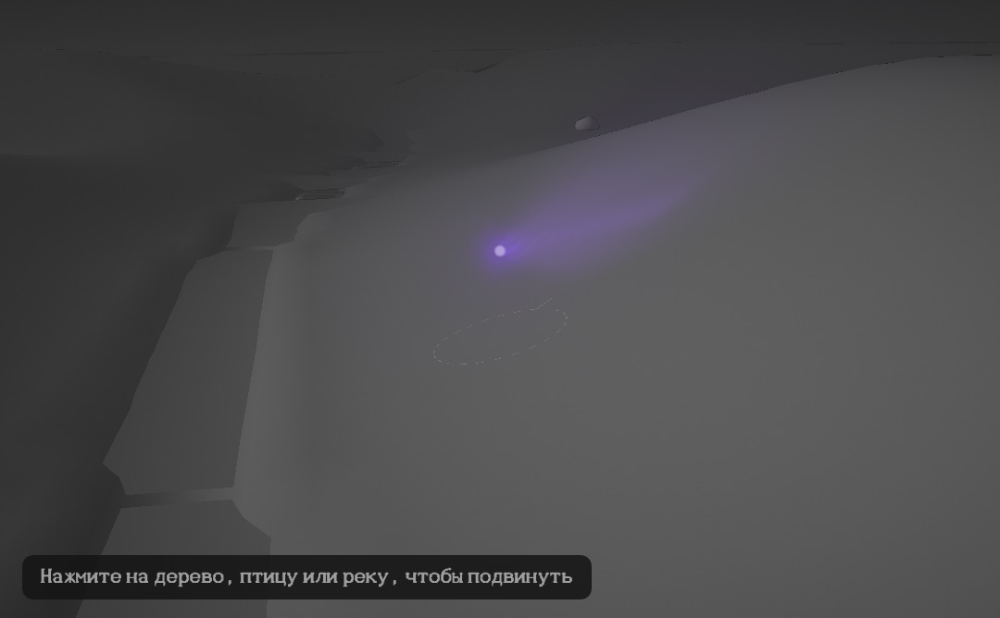
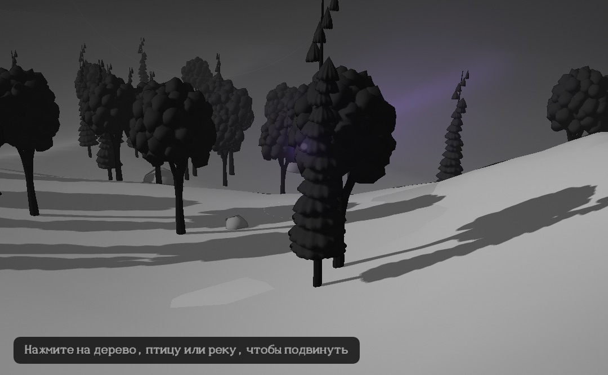
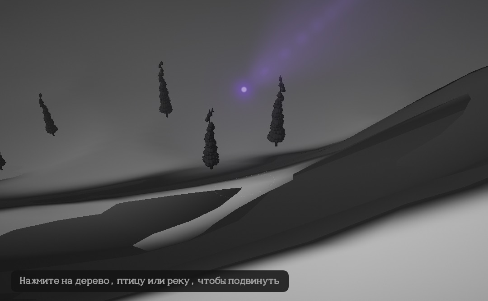
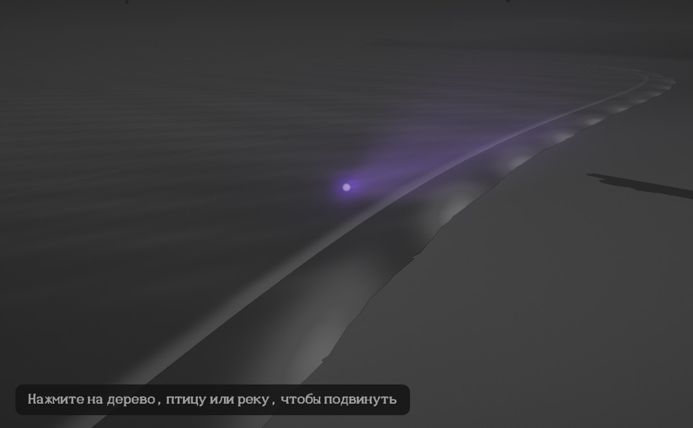
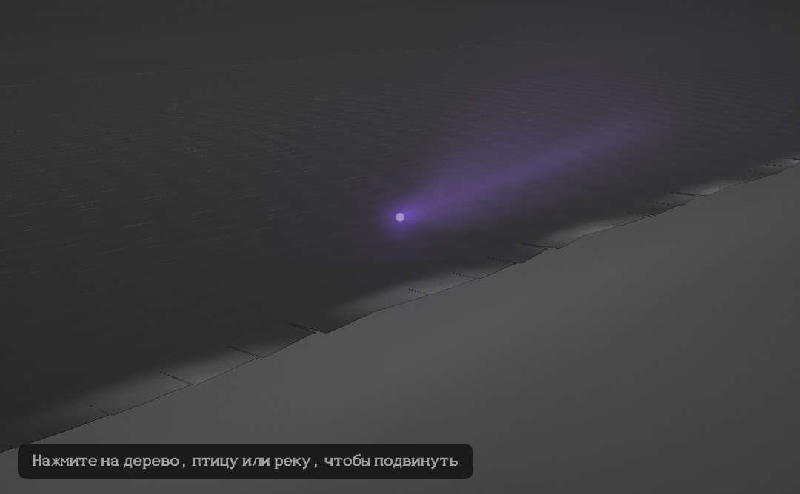
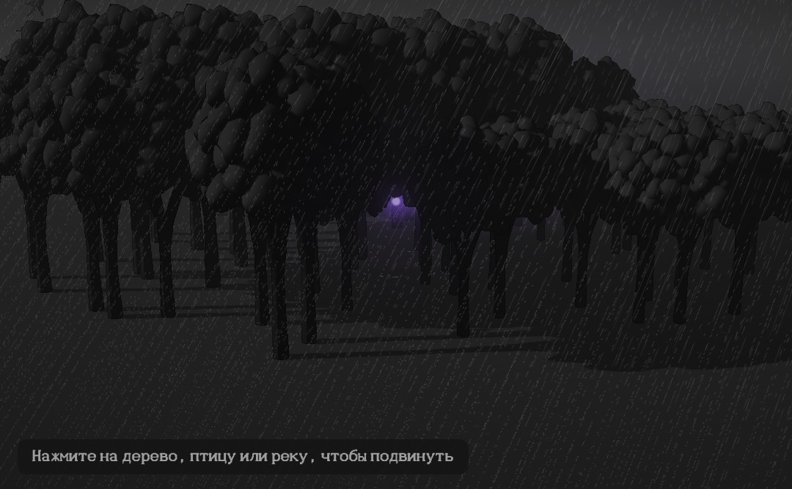
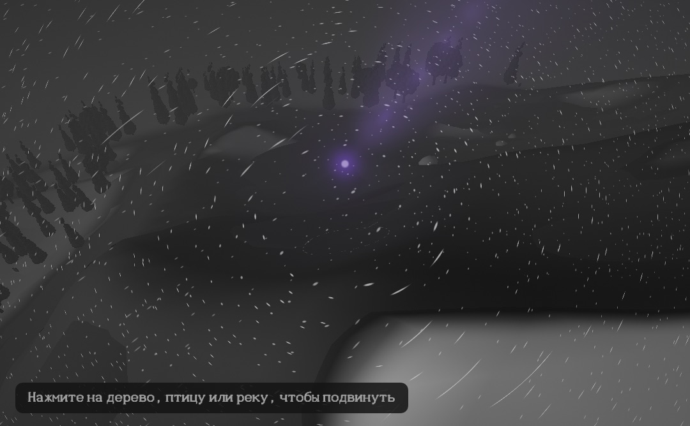
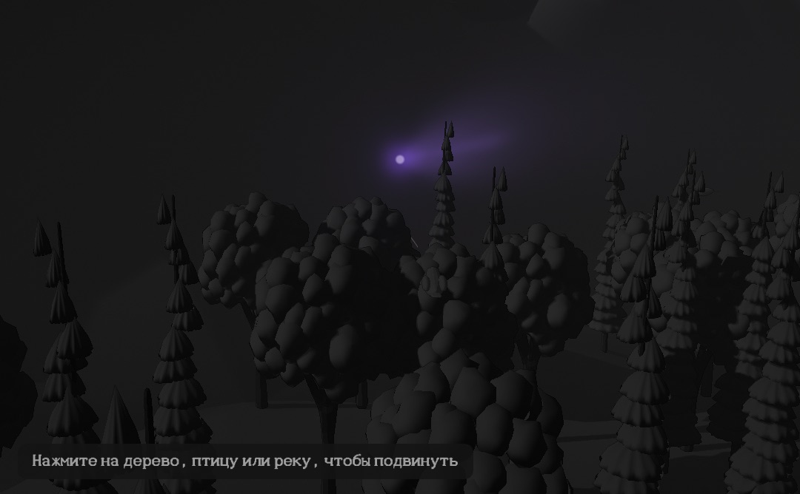
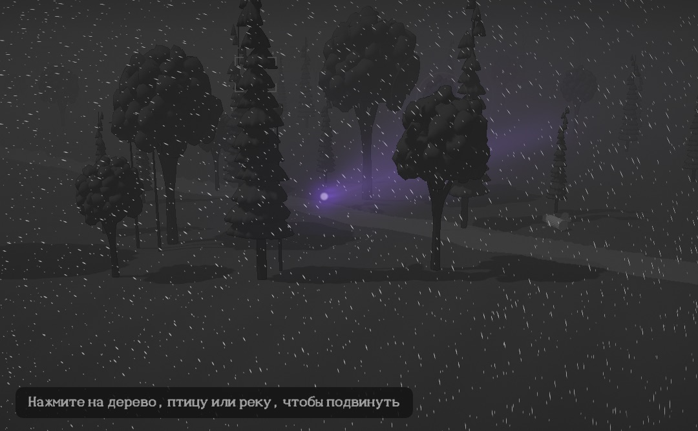

# The world of flight mode

Flight mode (docs/flight-mode.md) flies through an endless landscape that is generated, not
stored. This document is about the landscape itself: its relief, water, ground and weather,
and above all **where the landscape and the sound propagation meet**.

Code: `core/src/flight/terrain.rs` (relief, water, surfaces, the UI's sampler),
`core/src/flight/land.rs` (biomes, features, streaming, terrain caches, sound sites, birds),
`core/src/flight/acoustic.rs` (terrain diffraction, slope echoes, enclosure),
`core/src/flight/mod.rs` (terrain following, stops, per-emitter terrain coupling),
`core/src/physics/ground.rs` (ground impedance incl. sand and rock), new sound models in
`core/src/sources/water.rs` (surf, big river), `wind.rs` (sand and snow saltation, ridge howl),
`rain.rs` (snowfall). App: `Stage/FlightTerrain.swift` (chunked relief and water meshes),
`Stage/Shaders.swift` (water, snow, sand, rock, precipitation), `Stage/SceneRenderer.swift`.

## Biomes (`flight.biome`)

The key stays `flight.biome` (a preset; names in English snake_case, index = position):

| # | name | relief | ground | water | life and sound |
|---|---|---|---|---|---|
| 0 | `mixed` | hills ±12 m | forest, grass | brooks, lakes, ridges | as before |
| 1 | `broadleaf` | hills ±9 m | forest | brooks | oaks, birch |
| 2 | `taiga` | hills ±16 m | forest, rock | lakes | spruce, pine; −4 °C |
| 3 | `river_valley` | hills ±22 m, broad valleys | forest, grass | many brooks in valleys | willows, alders |
| 4 | `meadows` | rolling ±7 m | grass | brooks | crickets, camps, breeze on crests |
| 5 | `highlands` | hills + ridged massifs (40 m) | rock on steep slopes, snow above 75 m | falls | wind howl on ridges |
| 6 | `desert` | transverse dunes (11 m, 80 m apart), draa swells | sand | rare oases | sand hissing over crests, sparse birds; +9 °C, windier |
| 7 | `snowy_mountains` | ridged massifs (170 m) and valleys | snow, rock on steep slopes; treeline 45 m | rocky brooks, frozen lakes | ridge howl, blowing snow, ravens; −14 °C, snowfall |
| 8 | `lake_shore` | hills ±10 m | forest, sandy beaches | big lakes (70..170 m semi-axes) | lapping all round |
| 9 | `sea_coast` | coast with beaches and cliffs | sand on the beach, rock on cliffs | the sea | surf (sand or shingle), gulls |
| 10 | `big_river` | floodplain, valley sides | forest, beaches | a 90 m wide river every ~1.5 km, banks | mid-stream boils, bank lapping |

The language control switches biomes generically (`flight.biome=desert`); option names come
from `asmr_get_control_option`.

### World controls (group FLIGHT)

| id | key | range | default | |
|---|---|---|---|---|
| 1009 | `flight.relief` | 0..2 | 1 | relief scale: 0 flat, 1 as the biome, 2 twice as steep. Regenerates like a new seed (0.8 s fade) |
| 1010 | `flight.stops` | 0..1 | 0.5 | how often and how long the flight eases down and lingers at places; 0 never |

## Relief (`terrain.rs`)

A heightfield, a **pure function of (seed, biome, relief, place)** plus the macro features of
`land.rs` (which are themselves pure functions of their cell):

* **Hills**: 2D gradient noise (Perlin, 12 directions, quintic fade), fBm with each octave
  rotated ~37°, so no grid shows. The slow part (`low`) also sets the levels of rivers.
* **Mountains**: ridged multifractal (`1 − |n|`, squared, weighted by the previous octave):
  sharp crests, broad valleys, masked by a slower field so massifs come and go.
* **Dunes**: transverse dunes across a per-seed wind, an asymmetric profile (gentle windward
  slope over 78 % of the wavelength, a steep slip face), domain-warped into crescents, with
  slow draa swells under them.
* **Coast**: a 1.4 km "continent" field thresholded at the sea's share, turned into metres
  from the shoreline; a 45 m beach rising 2.6 m, or cliffs (12 m+) where a second field says
  so; the seabed falls at 3.5 %.
* **Big river**: a meandering centre line (two sines) in a band every 1.5 km, a flat
  floodplain, banks rising over ~150 m.
* **Features carve it**: brooks and rivers run at a **level that only falls along their
  course** (the land under the path, smoothed, as a running minimum), so they flow one way and
  cut V-valleys (gorges where they cross a rise) with walls of ~1:2.5..1:6.5 by the biome's
  `valley`; **lakes** sit in a basin at the level of the lowest point of their rim; **ridges**
  are rocky crests 10..18 m wide, 6..26 m high.
* **Surfaces**: water where the water level is above the ground (frozen lakes count as snow),
  bare rock on slopes steeper than the biome's `rock_slope`, snow (snowy biome, or above the
  snowline), sand (desert, and beaches 2.6 m above the sea, lakes and the big river), forest
  floor or grass by the forest cover.

The audio thread never evaluates the relief: each tile caches it on a 5 m grid when it is
made (9 × 9 samples: ground, water level, surface; ≈80 µs per tile; worst streaming block
≈220 µs in the river valley, mean 1–2 µs per block at 25 m/s), and lookups are bilinear.
The UI samples the same function on its own thread (`asmr_terrain_new` /
`asmr_terrain_sample`), at 2.5 m near and 10 m far.

## Where the landscape and the sound meet

### 1. Positions on the relief

Everything stands on the relief: trees at their own ground (crowns at ground + crown height),
stands at their mean ground, birds and sites above the ground or the water surface, the
listener at `ground + altitude`. The flight level **follows the terrain**: it rides over the
highest ground in the next 0.6..2 s of flight (minus a little), rising with τ = 0.9 s and
sinking into valleys with τ = 2.2 s, never closer than 1.2 m to the ground. Every emitter
position is listener-relative, so a brook in the valley below is heard below, Doppler and
parallax as before.

### 2. Diffraction over hills and ridges (`acoustic::terrain_path`)

Every 4 blocks (~5 ms) and for every voiced emitter, the terrain profile between it and the
listener is sampled at 10 points from the tile caches. The **main edge** is the sample with the
largest Fresnel–Kirchhoff parameter

  v = h · √(2 (d₁ + d₂) / (λ d₁ d₂))

(h: height of the terrain above the line of sight, d₁, d₂: distances to the ends), and a
**secondary edge** is looked for on the longer side against the line to the main edge's top
(Deygout's method). Each edge attenuates by the knife-edge curve of ITU-R P.526

  J(v) = 6.9 + 20 log₁₀(√((v − 0.1)² + 1) + v − 0.1)  (v > −0.78, else 0),

computed at the 40 frequencies of the propagation's filter grid, summed and capped at 25 dB
like ISO 9613-2's barrier term (20 dB single, 25 dB double edge; Maekawa's chart gives the
same within a few dB for N = 2δ/λ). Low frequencies bend over a hill, high ones do not: a
brook behind a rise is a muffled murmur, then opens up as you crest it. An edge only counts in
proportion to how much it stands out of the straight line between the two grounds
(0.5..3 m): flat ground near grazing is the ground effect's business, not a barrier's.
The loss goes into the emitter's spectral EQ on both the direct and the ground path (the
sound director's EQ is added to it), and the mix layer is fed the 1 kHz loss so it knows the
source is hidden. The ridges of earlier versions (thin walls) are now part of the relief.

### 3. The ground under each path (impedance)

The same profile gives the **specular reflection point** (at hₛ/(hₛ + hᵣ) of the way from the
source) and the ground there: its height becomes the emitter's own reflecting plane
(`Emitter::ground_z`, a small hook in the propagation: a source in a valley below reflects
off the valley floor at a steep angle instead of grazing the listener's ground), and its
surface the emitter's ground type. Ground impedance follows Miki's (1990) refit of
Delany–Bazley (1970), the spherical-wave reflection coefficient Q = R_p + (1 − R_p) F(w)
(Chien & Soroka 1975), with effective flow resistivities (Embleton, Piercy & Daigle 1983;
Attenborough, Li & Horoshenkov 2007):

| surface | σ, kPa·s/m² | |
|---|---|---|
| fresh snow | 20 (10..30) | very absorbent: the ground dip moves low and deep, the highs die over snow |
| forest floor | 40 (20..80) | |
| grass | 200 (150..300) | |
| loose sand | 250 (100..500) | new: `GroundType::Sand` (`ASMR_GROUND_SAND` 6) |
| bare rock | 3000 (2000..4000) | new: `GroundType::Rock` (`ASMR_GROUND_ROCK` 7), nearly rigid |
| water | rigid | |

The listener's own ground (the environment's `ground`, which also sets the floor absorption
of the late reverb) follows the surface under the listener.

### 4. Slope echoes (`acoustic::Echoes`)

Every ~20 ms the listener looks in 16 directions out to 195 m for **visible, steep terrain
facing it** (a rise of more than 1 m with slope > 0.25 that is not hidden by nearer ground).
The strongest four (not two from neighbouring directions) become image-source taps on a shared
delay line, delay 2r/c, gain

  g = R · sin(face slope) · min(rise / 10 m, 1) · 25 / (2r + 25),

with R the surface's reflection (rock 0.9, sand and grass 0.55, forest 0.3 because trees
scatter, snow 0.3 because it absorbs), and a roughness low-pass (5 kHz rock .. 1.5 kHz
snow). The input is the field at the listener (each emitter's block × gain / (distance + 4)).
Each echo is encoded in the direction of its face, so in a valley the walls answer from both
sides, and a cliff over the sea throws the surf back. Taps glide when the face moves and
fade out, jump and fade in when the reflector changes (no chirps).

### 5. Enclosure and reverb

The same scan measures the **enclosure**: the mean sine of the skyline elevation all around
(0 on an open plain or dune field, ~0.2 in a valley, more in a deep cirque). The late reverb
level becomes ×(0.6 + 2.2·enclosure) (≤ 1.8), ×0.6 over snow; the forest tail itself still
comes from the stand density (none in the desert: there only the echoes ring).

### 6. Weather and climate

Biomes shift the temperature (desert +9 °C, snowy mountains −14 °C) and the wind over the open
land (×0.9..1.4). Precipitation falls as **snow** in the snowy biome or below 0.5 °C: the rain
patches switch to `snowfall` (flakes landing at ~1 m/s, a soft dull touch at
(1/6)^1.5 ≈ −23 dB of a raindrop's impact), and rain stops pattering on leaves and water. In
the scene, `env.temperature < 0` turns rain into snow too.

## New sound models

* **Surf** (`Water` with `surf`, `swell_s`, `shingle`; presets `sea_surf`, `rock_surf`): a
  plunging breaker dissipates the wave energy flux ∝ H²T in a few seconds: a broadband crash
  (a curtain of bubbles too dense to resolve, a Campbell bed in three bands) at H^1.5·√T, the
  swash hissing up the beach, the backwash draining through sand or rattling shingle (pebble
  clicks at a rate ∝ backwash × shingle), wave groups every ~6.5 periods, a continuous roar of
  the breakers along the rest of the shore. Up to three breakers overlap. Sites: one per tile
  on the shoreline (40 m of shore each), rocky under cliffs.
* **Big river** (`big_river` mid-stream: deep, smooth, boils and gulps; `river_bank`: slow
  water and small waves lapping), sites every 30 m along the centre and both banks.
* **Saltation** (`Wind` with `sand`, `sand_hz`, `sand_threshold_ms`; presets `dune_sand`,
  `blowing_snow`): grains hop once the wind passes the threshold (Bagnold 1941, Owen 1964),
  mass flux q ∝ u³(1 − u_t²/u²); the hiss of countless impacts has power ∝ q, a band at
  ~6 kHz (sand) or ~4 kHz (snow), fluttering with the turbulence. Silent below ~5 m/s.
* **Ridge howl** (`ridge_howl`): rough body from the crags and a low cavity howl (140 Hz)
  coming and going with the gusts.
* Air sites: one per tile at its most exposed point (dune crest, rocky ridge, open hilltop),
  voiced by a new pool of 4 slots (3 at once).

Levels (raw generators, unit gain; brook segment −43.9 dB): sea surf (40 m of shore)
−13.7 dB RMS with 16 dB swing between breakers, rock surf −10.6, big river −39.9, bank
−42.3; dune sand −55 dB at 2 m/s, −24 at 9 m/s; ridge howl −15, blowing snow −21 at 9 m/s.

## Stops and slow-downs (`flight.stops`)

Places worth lingering carry a `scenic` flag: lake shores, waterfalls, campfires, a quarter of
the surf, an eighth of the big river's banks, high viewpoints. Every ~5 ms the flight looks
ahead (within ±53° when wandering, ±25° when steered by head, 30..320 m) for one it has not
visited; a share `0.1 + 0.85·stops` of them, decided once per place by hash, is accepted. Then:

1. **Approach**: when not steered by head the course turns towards it; the speed is capped by
   v = √(2·1 m/s²·(d − 10 m)), so the flight eases down over the last ~100 m.
2. **Linger** (14 + 30·stops s, ±30 % per place): standing still, the flight level comes down
   to standing height, the airflow falls silent, and the place sounds around you.
3. **Fly on**: back to the cruise speed at the usual 2.5 m/s², a cooldown of 40 − 25·stops s.

On a sea coast the wandering course also keeps to the shore (it turns back when the sea lies
ahead, drifts towards it far inland).

## Birds

The five open biomes take their birds from the bird director's tables
(`director::species_weights_for_biome`, `bird_density_for_biome`, `pick_species_for_biome`):
tree birds in the oasis and shore trees, and birds of the open per tile (1.6 × density): larks
hovering 12..35 m up in song flight, gulls and ravens soaring, the rest low on the ground
(never on water). The forest biomes keep their tree-species weights, multiplied by the
`land::species_weight(species, &Habitat)` hook (`Biome::habitat`, `Land::habitat_at` adds water
and coast nearby). Flight-mode bird slots now include blackbird, skylark, gull and raven, and
the flush distance comes from the species data.

## The picture (Stage/)

* **Relief**: `FlightTerrain` samples the engine's relief in world-anchored chunks (40 m at
  2.5 m near, 160 m at 10 m far, out to ~560 m), meshes each once (triangles split along the
  shorter diagonal so crests stay sharp) and draws it with a model matrix into the travel
  frame, so nothing swims as you fly or turn. Far chunks hidden by near ones are skipped.
  Trees, birds and boulders come with their own ground heights. The flight camera sees to
  ~640 m and never dips inside a hill (it rises over slopes between it and the herm); the sun
  is lower in flight (raking light shows the relief) and stays put in the world.
* **Ground**: snow pale, sand mid grey, bare rock dark on steep slopes, beaches by height above
  the water; an aerial perspective over the relief (fog span 50 m × the haze scale).
* **Water**: flat meshes at the water level per vertex, carrying depth, flow and kind. A
  normal from a few travelling waves in world space: rivers ripple downstream at their flow
  speed with foam flecks, lakes shiver in patches of cat's-paws, the sea swells; Schlick
  Fresnel mixes a dark body with the haze's reflection (bright at grazing angles), glints of
  the sun, foam where it is shallow and, on the sea, bands running up the beach. Fine waves
  fade with distance (no moiré).
* **Rain and snow over the whole scene**: four layers of particles 2.5..23 m from the eye,
  each hidden behind nearer things; their screen direction and speed are the projection of the
  air's motion past the eye at that depth (fall, wind, flight), so near drops streak fast and
  long, far ones drift, and in fast flight they slant towards you. Rain: thin motion-blurred
  streaks and faint rings where drops land nearby. Snow: soft swaying flakes. Density follows
  the rain rate; snow when the engine says so (flight) or below 0 °C (scene).

Snapshots (`ASMRX3000 --snapshot out.png --flight 6 --seed N --set flight.biome=NAME`;
`--set` now also takes option names):

| | |
|---|---|
|  desert, seed 15 |  snowy_mountains, seed 9 |
|  snowy_mountains, seed 2 |  sea_coast, seed 28 |
|  lake_shore, seed 29 |  big_river, seed 26 |
|  meadows, rain 8 mm/h |  snowy_mountains, snowing |
|  highlands, seed 3 |  the scene at −5 °C |

## Measurements

Apple Silicon, release, 48 kHz, 512-frame blocks, 60 s at 12 m/s, seed 1
(`cargo run --release --example flight -- 60 out 12 BIOME 1 [rain]`):

| biome | CPU % of one core | RMS dBFS |
|---|---|---|
| mixed | 9.2 | −25.3 |
| broadleaf | 9.5 | −26.8 |
| taiga | 7.9 | −22.7 |
| river_valley | 9.4 | −26.6 |
| meadows | 8.8 | −26.0 |
| highlands | 8.6 | −25.1 |
| desert | 3.8 | −27.5 |
| snowy_mountains | 6.7 | −26.7 |
| snowy_mountains, snowing 3 mm/h | 6.9 | −26.7 |
| lake_shore | 7.3 | −26.5 |
| sea_coast | 6.1 | −25.4 |
| big_river | 4.6 | −26.6 |

`core/tests/flight_alloc.rs` (now also switching to `sea_coast` with stops on half way)
renders with zero allocations on the audio thread.

## Tests

`cargo test --manifest-path core/Cargo.toml`: `terrain::tests` (noise bounds, relief per
biome), `landscapes_have_their_features` (per biome: trees, rivers, surf, big river, air
sites), `hills_hide_and_muffle_sources` (paths hidden behind mountain ridges lose more highs
than lows, capped at 25 dB; flat ground hides nothing), `valleys_answer_and_plains_are_open`
(echoes and enclosure in the mountains, none on a flat meadow), `flight_stops_at_places_and_flies_on`,
`frame_tells_the_ui_where_and_what` (the UI sampler sees the engine's ground),
`surf_breaks_and_rivers_flow`, `sand_hisses_only_in_a_wind`. Ignored helpers:
`find_scenic_seeds` (seeds whose start shows water), `print_profile`, `chunk_generation_cost`.

## Limits

* The propagation still has one flat ground plane per emitter (at the specular point's
  height); the ground effect of a slope (a tilted plane) and multiple reflections in a narrow
  gorge are approximated by the slope echoes and the reverb level.
* Terrain diffraction adds no detour delay (the extra path over a crest is a few cm to a few
  m: < 10 ms) and uses one main and one secondary edge.
* Rivers' water level only falls along a 430 m segment; two crossing rivers do not join.
  Brooks narrower than ~2.5 m are drawn at the near grid's resolution.
* Sea waves are not drawn as moving geometry; the surf is in the foam bands and the sound.
* Trees are still the scene's four models (spruce or broadleaf by species); deserts have no
  shrubs, snow does not sit on the crowns.
